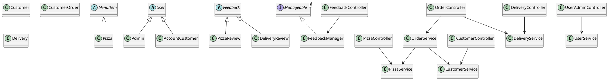

# Class diagram (PlantUML)

## Layer responsibilities

Controllers accept web requests and return Thymeleaf views. Services apply validation and CRUD rules. The pizza service uses Spring Data JPA. Account, customer, order, delivery, and feedback records use JDBC with MySQL. Models represent the application records and shared OOP types.

## OOP concepts to explain in the viva

- **Encapsulation:** model fields are private and updated through validated service/model methods.
- **Inheritance:** `Pizza` extends `MenuItem`; account types extend `User`; `PizzaReview` and `DeliveryReview` extend `Feedback`.
- **Polymorphism:** the feedback manager handles both review subclasses through the shared `Feedback` type.
- **Abstraction:** `MenuItem`, `User`, and `Manageable` define shared contracts.
