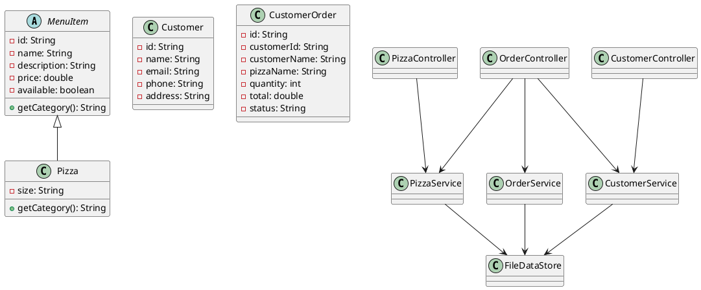

# Class diagram (PlantUML)

## Viva explanation
The controllers receive browser requests. Services apply application rules. `FileDataStore` reads and writes text files. Model classes represent pizzas, customers and orders. `Pizza` inherits from `MenuItem`, demonstrating inheritance. Services use the abstract parent type `MenuItem`, demonstrating polymorphism.
